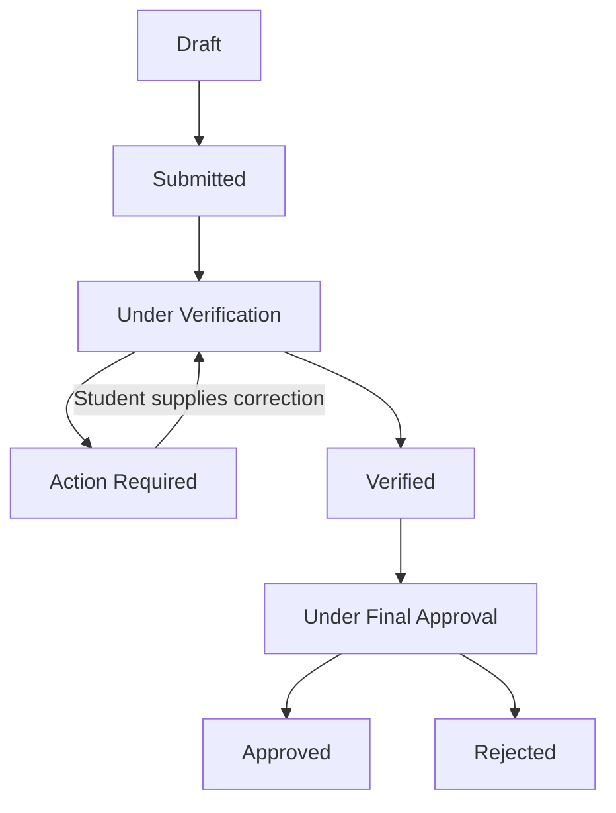

# Digital Scholarship Application and Approval Management System

**Scholarship Desk** · MERN stack · Student / Verifier / Admin · White and dark themes

A college scholarship portal where students maintain one profile, reuse their documents, find scholarships they qualify for, and review autofilled applications before submitting them. Scholarship officers verify applications, and administrators make the final decision.

> **Project status: starter scaffold.** This README documents the agreed product specification and the current code structure. The project contains initial models, application entry points, and placeholder screens. Most end-to-end features still require implementation. See [Current implementation status](#2-current-implementation-status).

## Contents

1. [Project overview](#1-project-overview)
2. [Current implementation status](#2-current-implementation-status)
3. [Problem statement and objectives](#3-problem-statement-and-objectives)
4. [Scope and agreed decisions](#4-scope-and-agreed-decisions)
5. [Roles and permissions](#5-roles-and-permissions)
6. [Complete feature specification](#6-complete-feature-specification)
7. [Registration, login, and password recovery](#7-registration-login-and-password-recovery)
8. [Eligibility engine and autofill](#8-eligibility-engine-and-autofill)
9. [Application lifecycle and duplicate prevention](#9-application-lifecycle-and-duplicate-prevention)
10. [Documents and expiry alerts](#10-documents-and-expiry-alerts)
11. [Admin Excel and CSV import](#11-admin-excel-and-csv-import)
12. [Architecture and technology stack](#12-architecture-and-technology-stack)
13. [Data models and relationships](#13-data-models-and-relationships)
14. [Project file structure](#14-project-file-structure)
15. [API design](#15-api-design)
16. [UI and accessibility](#16-ui-and-accessibility)
17. [Local setup and configuration](#17-local-setup-and-configuration)
18. [Security and data protection](#18-security-and-data-protection)
19. [Performance and the 5000-user target](#19-performance-and-the-5000-user-target)
20. [Testing and acceptance criteria](#20-testing-and-acceptance-criteria)
21. [Deployment plan](#21-deployment-plan)
22. [Development roadmap and future scope](#22-development-roadmap-and-future-scope)
23. [Troubleshooting and references](#23-troubleshooting-and-references)

---

## 1. Project overview

| Item | Details |
| --- | --- |
| Official project title | Digital Scholarship Application and Approval Management System |
| UI working name | Scholarship Desk |
| Project type | Full Stack Development Project |
| Student | Akash I |
| Register number | 310624104013 |
| Department | Computer Science and Engineering |
| Institution | Easwari Engineering College |
| Guide / Trainer | Ms. Nagamani |
| Core stack | MongoDB, Express.js, React.js, Node.js |
| Primary users | Students, scholarship officers, administrators |
| Documentation updated | 24 September 2026 |

### Central idea

Students enter scholarship-related information once and upload a reusable set of documents. The system compares their profile with scholarship rules, explains eligibility, and fills eligible application forms for review.

The student controls the final submission. The verifier checks the evidence, and the admin decides whether to approve or reject the application.

### Main differentiator

The **Dynamic Scholarship Eligibility Engine** lets an admin configure conditions such as CGPA, family income, department, current year, or first graduate status through the dashboard. Adding a scholarship with supported rule types does not require writing new backend logic.

Eligibility is a preliminary match against the rules. It does not guarantee approval or payment.

## 2. Current implementation status

The repository is a starting point for development, not a finished deployed portal.

| Area | What exists now | What remains |
| --- | --- | --- |
| Project organization | Separate React client and Express server | Complete business modules and integration |
| React frontend | Entry point, basic route table, heading-only role pages, reusable component placeholders | Working forms, protected routes, dashboards, API integration |
| Theme | White/dark CSS foundation; React theme button placeholder | Working React theme state and persistent preference |
| Express backend | JSON handling, CORS, Helmet, health endpoint, mounted route modules | Functional API handlers and request validation |
| MongoDB | Connection helper and nine initial Mongoose models | Complete fields, relationships, validation, migrations/index deployment |
| Authentication | OTP schema, random-code helper, JWT helper | Registration, login, email delivery, recovery, cookies, authorization |
| Eligibility | `evaluateEligibility()` placeholder | Actual rule evaluation, missing-data handling, explanations |
| Applications | Initial snapshot fields and compound unique-index declaration | Review, submission, server checks, revisions, approval transitions |
| Excel import | Service/controller/validator placeholder files and sample CSV | Real parsing, preview, validation, import, error reports |
| Document expiry | Document expiry field plus job/service placeholders | Upload versioning, expiry logic, scheduler and reminders |
| Tests and deployment | Documentation and startup scripts | Automated tests, build verification, deployment, load testing |

**Important implementation gaps:**

- The authentication and role middleware files do not yet enforce access.
- Role pages currently exist as unprotected placeholders; this must change before real use.
- Route modules are mostly empty. The defined `GET /api/health` route is the basic backend check.
- The eligibility placeholder is not a working eligibility engine.
- `client/vite.config.js` is not yet present; the declared React plugin still needs configuring.
- There is no seeded admin account, completed test suite, scheduled worker, or verified 5,000-user capacity.
- Dependencies have not been installed, audited, and integration-tested as part of this documentation update.

A separate HTML UI prototype was created earlier. Its sample data, expiry banners, and import preview demonstrate the intended interface; they do not perform real Excel parsing, email delivery, or database writes.

## 3. Problem statement and objectives

### Problem statement

Manual scholarship administration often involves paper forms, repeated data entry, repeated certificate submission, spreadsheet tracking, manual eligibility checks, and unclear approval progress. Students have difficulty knowing which scholarships apply to them or what action is needed. Staff spend time checking the same information across multiple applications.

### Objectives

- Centralize scholarship administration in one institution-controlled portal.
- Allow only recognized students to register.
- Reduce repeated data entry through reusable profiles and autofill.
- Reuse supporting documents while respecting their validity.
- Explain eligibility results clearly.
- Separate student-account approval from scholarship-application approval.
- Support correction requests without creating duplicate applications.
- Preserve application evidence and an audit trail.
- Simplify administration through bulk imports, reports, and academic-year promotion.
- Provide usable mobile and desktop interfaces in light and dark modes.

## 4. Scope and agreed decisions

| Topic | Agreed design |
| --- | --- |
| Application platform | MERN web application with three user roles |
| Student identity | Register number and approved college email must match the same Student Master record |
| Student username | College email is used as the login username |
| First registration | College-email OTP, password creation, then verifier account approval |
| Normal login | College email and password; OTP is not sent for every login |
| Password recovery | OTP to the saved college email, then a new password |
| OTP lifetime | Six-digit code, valid for **30 seconds** after provider acceptance of the send request |
| Application autofill | Available after eligibility checks; student must review and confirm |
| Duplicate rule | One application per student, scholarship, and academic year |
| Official academic data | Admin-controlled; students cannot change department, register number, year, or academic year |
| Student Master import | Admin uploads Excel/CSV, reviews validation, then confirms |
| Appearance | Clean white theme with soft accents, plus dark mode |
| Scale objective | Approximately 5,000 students; simultaneous load must be measured |

The three specifically selected additions are:

| Original suggestion number | Accepted addition |
| --- | --- |
| 1 | Document expiry alerts |
| 2 | Duplicate application prevention |
| 11 | Admin bulk Student Master import using Excel/CSV |

**Scope boundary:** autofill applies to application forms hosted inside this portal. Filling an unrelated external government or scholarship website would require a separate integration and is not part of this specification.

Actual college email domains, approved department codes, scholarships, deadlines, and award amounts must be configured by the institution. Examples in this document are illustrative.

## 5. Roles and permissions

| Capability | Student | Verifier | Admin |
| --- | --- | --- | --- |
| Register and verify college email | Own account | No public registration | No public registration |
| Maintain student scholarship profile | Own permitted fields | Review relevant records | Manage authorized records |
| View or download documents | Own documents | Assigned/authorized reviews | Authorized administration |
| Review and submit an application | Own applications | No | No |
| Approve a student account | No | Yes | Manage accounts |
| Request application corrections | No | Yes | Review final decision evidence |
| Verify an application | No | Yes | Monitor |
| Make final scholarship decision | No | No | Yes |
| Create scholarships and rules | No | No | Yes |
| Import Student Master records | No | No | Yes |
| Create verifier accounts | No | No | Yes |
| Promote academic years | No | No | Yes |
| View reports and audit history | Own application history | Relevant review history | Institution-wide |

Backend checks must verify both role and record ownership or assignment. Hiding a navigation item is not authorization.

Verifier accounts are created by the admin. The first admin must be provisioned through a controlled setup/seed process; users cannot choose `admin` or `verifier` during public registration.

## 6. Complete feature specification

| Module | Required behavior |
| --- | --- |
| Student Master | Maintain approved institutional records and registration status |
| College-email registration | Check domain and exact register-number/email pairing |
| Email OTP | Secure generation, 30-second lifetime, limited attempts, controlled resend |
| Account verification | Verifier approves or rejects a pending student account |
| Login and recovery | Common login page, role redirect, password reset using college-email OTP |
| Reusable profile | Academic, family, category, contact, and bank information |
| Document repository | Private uploads, reuse, review status, versions, expiry dates |
| Dynamic eligibility | Admin-defined rules and understandable reasons for failure |
| Scholarship management | Create, update, activate/deactivate, deadlines, required documents, custom questions |
| Discovery | Search, filter, eligibility indicators, existing-application status |
| Autofill and review | Fill official/profile data, attach eligible documents, collect remaining answers |
| Submission | Server-side recheck, explicit consent, immutable original snapshot |
| Duplicate prevention | Database-enforced uniqueness for student, scholarship, and academic year |
| Correction workflow | Specific remarks, corrected evidence, recheck within the same application |
| Final approval | Admin approval/rejection after verifier review |
| Tracking | Status timeline with relevant dates and remarks |
| Notifications | Account decisions, submission, corrections, verification, final decisions, expiry reminders |
| Document expiry alerts | Dashboard/email reminders and renewed document versions |
| Excel/CSV import | Template, row validation, duplicate detection, preview, confirmed import, error report |
| Academic promotion | Advance years, graduate final-year students, preserve historical records |
| Reports | Counts by department, scholarship, year, and status; approval and processing metrics |
| Audit logs | Actor, action, timestamp, remarks, and status changes |
| Themes and accessibility | White/dark modes, responsive layouts, clear labels, accessible status feedback |

### Reusable student profile

Official values come from Student Master. Student-editable information can include CGPA, percentage, family income, category, gender, first graduate status, disability status, address, phone number, and bank details.

Collect only fields required by the institution's scholarship process. Require supporting evidence when appropriate. Display missing required data before submission.

### Academic-year promotion

Admin previews and confirms promotion of a chosen cohort:

- Year 1 becomes Year 2.
- Year 2 becomes Year 3.
- Year 3 becomes Year 4.
- Year 4 becomes `graduated`; do not store an invalid fifth year in a four-year schema.

Record the previous year, new year, academic session, admin, and timestamp. Guard against running the same promotion twice. Previously submitted applications retain their original academic-year snapshots.

## 7. Registration, login, and password recovery

### Student registration

1. Student enters their register number, approved college email, and chosen password.
2. Backend normalizes inputs and validates the exact allowed email domain.
3. Backend matches the register number and email to one active, unclaimed Student Master record.
4. Backend creates a registration challenge and sends a six-digit code to that saved email.
5. Student enters the OTP before it expires.
6. Backend verifies purpose, recipient, expiry, attempt count, and unused status, then consumes the challenge.
7. Account is created with role `student`, `emailVerified: true`, `accountStatus: "active"`, and `verificationStatus: "not_required"`.
8. The student is immediately able to log in with their college email and password, view their dashboard, complete their profile, upload documents, browse eligible scholarships, and submit applications.
9. Account approval is removed from student registration. Scholarship application review is strictly separated from login access:
   - **Student Account**: Active immediately upon college email OTP verification.
   - **Scholarship Applications**: Submitted → Under Verification → Approved / Rejected (reviewed by verifiers along with uploaded supporting documents).

Email ownership and college identity are separate checks. Matching the Student Master pair prevents a student from claiming another student's register number using their own college email.

The final account creation and Student Master claim must be consistent and duplicate-safe. A failed OTP attempt must not permanently mark a student as registered.

### Normal login

Use one login page for all roles. Students enter college email and password. On success, the server derives the role from the stored account and the frontend routes directly to the student dashboard (`/student`).

Login is protected by:
* User exists.
* Password matches hash.
* `emailVerified === true`.
* `accountStatus === "active"`.

Login is not blocked by student account verification status. Verifiers review submitted scholarship applications and uploaded documents, not student login accounts. Normal login does not require another email OTP.

### Forgot password

1. Accept the college email/username.
2. Return a neutral message, whether or not an account exists.
3. Send the recovery code only to the stored verified college email, if eligible.
4. Verify and consume the password-reset OTP.
5. Issue a short-lived, single-use authorization restricted to setting a new password.
6. Collect the new password and confirmation, validate them, and save the password hash.
7. Invalidate earlier sessions/tokens through the implemented session-revocation mechanism.
8. Notify the student of the reset and return them to normal login.

Do not treat successful OTP verification as an unrestricted login session. See the [OWASP password-recovery guidance](https://cheatsheetseries.owasp.org/cheatsheets/Forgot_Password_Cheat_Sheet.html).

### OTP policy

| Setting | Requirement |
| --- | --- |
| Code | Six digits from a cryptographically secure generator |
| Lifetime | 30 seconds, as selected for this project |
| Delivery boundary | Expiry starts when the email provider accepts sending, not when a job first enters a queue |
| Storage | Store a secure hash or keyed digest; never log the code |
| Use | One successful use; challenge is tied to email and purpose |
| Attempts | Proposed default: 5; enforce on the backend |
| Resend | Proposed cooldown: 30 seconds, with broader request limits |
| Replacement | Issuing a replacement invalidates the previous challenge |
| Countdown | Display from server expiry time; browser state cannot extend validity |

Email can arrive after the provider accepts it. A strict 30-second lifetime can therefore cause delivery-related expiry; the system must show a clear resend option and must not claim that the recipient has received the message.

Always compare `expiresAt` with server time. MongoDB TTL deletion is cleanup, not an exact expiry check; expired records can remain temporarily. See [MongoDB TTL behavior](https://www.mongodb.com/docs/manual/core/index-ttl/).

### User-facing messages

| Situation | Message |
| --- | --- |
| Personal/non-college email | “Please use your official college email address.” |
| Register number/email mismatch | “The register number and college email do not match our records.” |
| Expired code | “OTP expired. Request a new code.” |
| Pending approval | “Your account is waiting for scholarship officer approval.” |
| Recovery request | “If an eligible account exists, a code will be sent to its college email.” |
| Incorrect login | “Invalid college email or password.” |

## 8. Eligibility engine and autofill

### Admin-configured rules

Example for an illustrative merit scholarship:

```json
{
  "title": "Merit Scholarship",
  "academicYear": "2026-2027",
  "criteria": [
    { "field": "cgpa", "operator": ">=", "value": 8 },
    { "field": "familyIncome", "operator": "<=", "value": 250000 },
    { "field": "currentYear", "operator": "in", "value": [2, 3, 4] },
    { "field": "department", "operator": "in", "value": ["CSE", "IT"] }
  ]
}
```

| Operator | Meaning |
| --- | --- |
| `>=`, `>` | Numeric lower threshold |
| `<=`, `<` | Numeric upper threshold |
| `==`, `!=` | Equal or unequal after validating the expected type |
| `in` | Membership in an allowed list |

The initial rule list uses **AND** semantics: every condition must pass. AND/OR groups are a future extension.

Read `department`, `currentYear`, and official academic data from Student Master; read scholarship facts such as CGPA and income from the profile. Allowlist supported fields and operators. Never evaluate arbitrary JavaScript or MongoDB operators from a rule.

Missing data should produce a “Complete your profile” explanation, not silently count as zero or qualify the student.

Example failed-condition response:

```json
{
  "eligible": false,
  "reasons": [
    {
      "field": "cgpa",
      "required": 8,
      "actual": 7.4,
      "message": "Required CGPA: 8.0. Your CGPA: 7.4."
    }
  ]
}
```

### Review and apply

1. Evaluate the chosen scholarship against the current official record and profile.
2. Open the review form only if the student is eligible.
3. Autofill fields and select saved document versions that satisfy that scholarship.
4. Keep institution-controlled fields read-only.
5. Ask for missing documents and scholarship-specific answers.
6. Require explicit student confirmation.
7. On submission, recheck eligibility, deadline, account status, document validity, and duplicate constraints on the server.
8. Save the original submission snapshot and create a notification/log.

Snapshot official information, profile values, scholarship/rule version, custom answers, and references to exact document versions. A later profile edit, document renewal, or rule change must not rewrite the original application.

## 9. Application lifecycle and duplicate prevention

### Approval flow



| Status | Meaning / permitted next action |
| --- | --- |
| Draft | Student is preparing the form; eligible draft may be submitted |
| Submitted | Received and waiting for verifier review |
| Under Verification | Officer reviews the details and evidence |
| Action Required | Student must address stated corrections |
| Verified | Officer has completed verification |
| Under Final Approval | Admin reviews the verified application |
| Approved | Final positive decision |
| Rejected | Final negative decision with a reason |

Account rejection is separate from application rejection. In the proposed application flow, the verifier requests corrections and the admin makes the final scholarship decision.

Backend transition rules must prevent students approving themselves or moving directly to a later stage. Updating a status, writing its audit event, and scheduling its notification must remain consistent.

### Duplicate rule

An existing index declaration in `Application.js` expresses the intended constraint:

```javascript
applicationSchema.index(
  { student: 1, scholarship: 1, academicYear: 1 },
  { unique: true }
);
```

- Keep a stable scholarship identity across academic years.
- Reuse an existing draft or correction flow rather than creating a second record.
- A rejected application still occupies that student's scholarship/year combination.
- A later academic year may have a new application.
- Catch database duplicate-key errors and return a controlled `409 Conflict` response.
- Frontend state and a preliminary “exists” check alone cannot prevent concurrent duplicates.
- Ensure the index is actually created in MongoDB. A Mongoose `unique` declaration is not an ordinary validator; see [Mongoose validation](https://mongoosejs.com/docs/validation.html).

### Corrections and audit history

A correction is a new revision of evidence on the same application. Keep the original snapshot and earlier document versions available for authorized review; do not silently overwrite them.

Log application creation/submission, review, correction request, replacement evidence, verification, forwarding, approval, and rejection. The target log fields are application, actor, role, action, previous/new status, remarks, and timestamp. Treat these records as append-only in the application API.

## 10. Documents and expiry alerts

### Upload and reuse

Supported document categories include identity proof, income certificate, community certificate, marksheet, first graduate certificate, disability certificate, bank evidence, and bonafide certificate.

The target metadata includes:

- Owner/student, document type, original filename, MIME type, and byte size.
- Private storage key and immutable version identifier.
- Uploaded timestamp, issue date, optional expiry date, and verification status.

Original files belong in private object storage; MongoDB stores their metadata. Allow reuse only of document versions meeting the scholarship's requirements.

An expiry date is optional. Do not invent expiry dates for certificates whose applicable rules do not require one.

### Expiry reminders

- Show the document name, expiry date, and next action in the dashboard and documents page.
- Proposed reminder schedule: 30, 7, and 1 day before expiry, plus an expired state. Make the schedule configurable by policy.
- Run a scheduled backend worker that identifies upcoming expiries.
- Send one reminder per document version and reminder threshold; retries must not create duplicate messages.
- Store expiry boundaries consistently and display dates using the institution's configured timezone.
- A renewed upload creates a new version and can require verification.
- Expired evidence must not be silently used for a new application.
- Historical submissions retain their original evidence and decision history.

The current `documentExpiryJob.js` and `documentExpiryService.js` files are placeholders; no real reminders are sent yet.

## 11. Admin Excel and CSV import

This feature imports **student records into Student Master**. It does not upload students' supporting certificates through a spreadsheet.

### Input format

Target formats: `.xlsx`, `.xls`, and `.csv`. The proposed limit is 5,000 student rows per import, excluding the header, with a separately configured file-size limit.

| Required column | Rule | Example |
| --- | --- | --- |
| `registerNumber` | Required, unique, stored as text | `DEMO20260001` |
| `name` | Required official name | `Demo Student` |
| `collegeEmail` | Unique, approved exact college domain | `student1@college.example` |
| `department` | Match an institution-approved code | `CSE` |
| `currentYear` | Integer from 1 to 4 for active students | `3` |
| `academicYear` | Valid institution academic-year format | `2026-2027` |

Format register-number cells as **Text** in Excel to preserve leading zeros and long identifiers. The sample domain `college.example` is a placeholder, not the institution's actual domain.

A starter CSV exists at [docs/STUDENT_IMPORT_COLUMNS.csv](docs/STUDENT_IMPORT_COLUMNS.csv). Its example details must be replaced with approved data.

### Import process

1. Admin downloads a template, completes it, and uploads the file.
2. Server checks file size/type, supported worksheet, required columns, and row limit.
3. Server parses records without evaluating spreadsheet formulas or macros.
4. Normalize strings and validate each row's types and allowed values.
5. Check duplicate register numbers and emails within the upload and against the database.
6. Display actual valid, invalid, duplicate, and conflicting-row counts with row-specific reasons.
7. Admin explicitly confirms which validated records to import.
8. Server revalidates conflicts and permissions at commit time and saves valid rows.
9. Return actual imported/skipped/failed counts and an error report.
10. Record the admin, import identifier, time, and result in audit history.

**Default policy:** create new records and flag existing/conflicting records. Updating existing official data needs a separate explicit update mode with a change preview and audit record; never overwrite it silently.

Importing a student does not create an approved login account. The student must still complete registration, college-email OTP verification, and account approval.

For large imports, use bounded batches and a retry-safe import identifier. Escape formula-like content in exported CSV reports. Confirm current SheetJS installation guidance before replacing the scaffold's old npm `xlsx` dependency; the upstream project notes that the public registry package is outdated: [SheetJS Node.js installation](https://docs.sheetjs.com/docs/getting-started/installation/nodejs/).

## 12. Architecture and technology stack

### Three tiers

| Tier | Responsibility | Technology |
| --- | --- | --- |
| Presentation | Role dashboards, forms, review screens, tracking, themes | React, Vite, React Router, Axios, CSS |
| Application | Authentication, validation, eligibility, approvals, imports, notifications | Node.js, Express.js |
| Data | Official records, users, rules, snapshots, metadata, audit history | MongoDB, Mongoose |

The React client calls REST endpoints. Express validates the request and delegates to services; services read or update MongoDB and call authorized email/storage integrations.

| Supporting component | Planned purpose |
| --- | --- |
| `bcryptjs` | Password hashing |
| `jsonwebtoken` | Signed authentication tokens |
| HttpOnly cookies | Browser token/session transport |
| Resend | Registration/recovery OTP and transactional notifications |
| Multer | Bounded upload intake |
| SheetJS or reviewed compatible parser | Excel/CSV parsing |
| Private S3 or a correctly configured private storage provider | Document versions and controlled downloads |
| Helmet, restricted CORS, validation, rate limiting | API protections |
| Scheduled worker and email queue | Expiry reminders and controlled email delivery |

These tools are not all wired into working features yet. Redis/shared stores and a queue can be introduced for deployment with multiple server instances; they are not present in the current scaffold.

## 13. Data models and relationships

Names below are the JavaScript model names. MongoDB collection names follow Mongoose configuration and should be made explicit if a particular naming convention is required.

| Existing model | Main purpose | Important target details |
| --- | --- | --- |
| `User` | Credentials, role, email verification, account approval | Link student accounts to Student Master; add session revocation metadata |
| `StudentMaster` | Official register number, name, college email, department, years | Unique identity fields, claim state, active/graduated status |
| `StudentProfile` | Reusable scholarship facts | One profile per student; typed fields and field-level validation |
| `Scholarship` | Description, academic year, deadline, rules, documents, custom questions | Stable scholarship ID and versioned rules/cycles |
| `Application` | Student, scholarship, academic year, snapshots, answers, status | Unique combination, submission timestamps, revisions |
| `Document` | Owner, document type, storage key, expiry | Private immutable versions and verification metadata |
| `Notification` | Recipient, title, message, read state | Event reference and retry/deduplication identifiers |
| `ApplicationLog` | Application, actor, action, remarks | Add previous/new state and actor role to full audit design |
| `Otp` | Email, purpose, code digest, expiry, attempts, used state | Challenge identifier, atomic use, resend/dispatch handling |

Relationships:

- One Student Master record is claimed by at most one student account.
- One student account owns one reusable profile and many documents/applications.
- One scholarship has many student applications.
- One application points to exact versions of its documents and has many audit entries.
- A notification is visible only to its recipient.
- OTP registration and password-reset purposes are not interchangeable.

The initial schemas use broad `Object` fields in several places. Typed nested schemas and stronger validation are needed during implementation; storing a plain object alone does not enforce immutability or correctness.

## 14. Project file structure

This is the current scaffold, including the environment example and ignore file. Generated dependencies, runtime secrets, and build output are not included.

```text
scholarship-management-system/
├── .gitignore
├── README.md
├── client/
│   ├── index.html
│   ├── package.json
│   └── src/
│       ├── App.jsx
│       ├── main.jsx
│       ├── components/
│       │   ├── applications/
│       │   │   └── ApplicationTimeline.jsx
│       │   ├── common/
│       │   │   └── ThemeToggle.jsx
│       │   ├── documents/
│       │   │   └── ExpiryAlert.jsx
│       │   ├── layout/
│       │   │   └── RoleLayout.jsx
│       │   └── scholarships/
│       │       └── EligibilityResult.jsx
│       ├── context/
│       │   └── AuthContext.jsx
│       ├── hooks/
│       │   └── useAuth.js
│       ├── pages/
│       │   ├── admin/
│       │   │   ├── AdminDashboard.jsx
│       │   │   └── StudentImportPage.jsx
│       │   ├── auth/
│       │   │   ├── ForgotPasswordPage.jsx
│       │   │   ├── LoginPage.jsx
│       │   │   ├── RegisterPage.jsx
│       │   │   └── VerifyOtpPage.jsx
│       │   ├── student/
│       │   │   ├── ApplicationReviewPage.jsx
│       │   │   ├── DocumentsPage.jsx
│       │   │   ├── ScholarshipsPage.jsx
│       │   │   └── StudentDashboard.jsx
│       │   └── verifier/
│       │       └── VerifierDashboard.jsx
│       ├── routes/
│       │   └── AppRoutes.jsx
│       ├── services/
│       │   └── api.js
│       └── styles/
│           └── theme.css
├── server/
│   ├── .env.example
│   ├── package.json
│   └── src/
│       ├── app.js
│       ├── server.js
│       ├── config/
│       │   ├── database.js
│       │   └── email.js
│       ├── controllers/
│       │   ├── adminController.js
│       │   ├── applicationController.js
│       │   ├── authController.js
│       │   ├── importController.js
│       │   ├── studentController.js
│       │   └── verifierController.js
│       ├── jobs/
│       │   └── documentExpiryJob.js
│       ├── middleware/
│       │   ├── authMiddleware.js
│       │   ├── errorMiddleware.js
│       │   ├── rateLimitMiddleware.js
│       │   ├── roleMiddleware.js
│       │   └── validationMiddleware.js
│       ├── models/
│       │   ├── Application.js
│       │   ├── ApplicationLog.js
│       │   ├── Document.js
│       │   ├── Notification.js
│       │   ├── Otp.js
│       │   ├── Scholarship.js
│       │   ├── StudentMaster.js
│       │   ├── StudentProfile.js
│       │   └── User.js
│       ├── routes/
│       │   ├── adminRoutes.js
│       │   ├── applicationRoutes.js
│       │   ├── authRoutes.js
│       │   ├── index.js
│       │   ├── scholarshipRoutes.js
│       │   ├── studentRoutes.js
│       │   └── verifierRoutes.js
│       ├── services/
│       │   ├── documentExpiryService.js
│       │   ├── emailService.js
│       │   ├── excelImportService.js
│       │   ├── notificationService.js
│       │   └── storageService.js
│       ├── utils/
│       │   ├── eligibilityEngine.js
│       │   ├── generateOtp.js
│       │   └── generateToken.js
│       └── validators/
│           └── studentImportValidator.js
└── docs/
    ├── API.md
    └── STUDENT_IMPORT_COLUMNS.csv
```

### Folder responsibilities

| Path | Responsibility |
| --- | --- |
| `client/src/pages/` | Screens grouped by role and authentication flow |
| `client/src/components/` | Shared UI elements and domain-specific widgets |
| `client/src/context/`, `hooks/` | Authentication/theme state and reusable React logic |
| `client/src/services/` | API client and request functions |
| `server/src/routes/` | URL definitions and middleware composition |
| `server/src/controllers/` | Request/response handling |
| `server/src/services/` | Reusable business logic and external integrations |
| `server/src/models/` | MongoDB schemas and indexes |
| `server/src/middleware/` | Authentication, authorization, validation, rate limits, errors |
| `server/src/validators/` | Import/input validation rules |
| `server/src/jobs/` | Background task entry points |
| `server/src/utils/` | Eligibility evaluation, token and OTP helpers |
| `docs/` | Supporting documentation and import example |

Additional files such as `vite.config.js`, protected-route components, complete profile/tracking pages, test directories, seed scripts, queue configuration, and document/import-history models can be added during implementation. They are not represented as existing files above.

## 15. API design

**Status:** only the health route has a handler in the current scaffold. The route prefixes exist; endpoints below are the proposed implementation contract.

| Method and endpoint | Access | Intended purpose |
| --- | --- | --- |
| `GET /api/health` | Public | Existing basic service response |
| `POST /api/auth/register` | Public, limited | Validate student identity and request registration OTP |
| `POST /api/auth/verify-otp` | Challenge-bound | Complete registration after valid OTP |
| `POST /api/auth/resend-otp` | Challenge-bound, limited | Invalidate old challenge and send a replacement |
| `POST /api/auth/login` | Public, limited | Password login |
| `POST /api/auth/logout` | Authenticated | Revoke/clear current session |
| `GET /api/auth/me` | Authenticated | Return safe account and role details |
| `POST /api/auth/forgot-password` | Public, limited | Request password-reset OTP |
| `POST /api/auth/verify-reset-otp` | Challenge-bound | Issue restricted reset authorization |
| `POST /api/auth/reset-password` | Reset authorization | Set new password and revoke earlier sessions |
| `GET /api/students/profile` | Student, own | Read merged official/profile details |
| `PUT /api/students/profile` | Student, own | Update only permitted profile fields |
| `GET /api/students/documents` | Student, own | List reusable documents and validity |
| `POST /api/students/documents` | Student, own | Upload a document version |
| `GET /api/students/documents/:id/download` | Owner/authorized reviewer | Authorize private download |
| `GET /api/scholarships` | Approved student/staff | Paginated scholarship listing |
| `GET /api/scholarships/:id/eligibility` | Approved student, own | Eligibility result and reasons |
| `POST /api/scholarships` | Admin | Create scholarship/rules |
| `PUT /api/scholarships/:id` | Admin | Update scholarship with version handling |
| `POST /api/applications/preview` | Approved student | Prepare autofilled review data |
| `POST /api/applications` | Approved student | Submit or return existing application conflict |
| `GET /api/applications/my` | Student | Own application list |
| `GET /api/applications/:id` | Owner/authorized staff | Application detail and history |
| `PATCH /api/applications/:id/corrections` | Owner, action required | Submit corrected evidence |
| `GET /api/verifier/registrations` | Verifier | Pending student-account queue |
| `PATCH /api/verifier/registrations/:id` | Verifier | Approve/reject account with remarks |
| `PATCH /api/verifier/applications/:id/status` | Verifier | Allowed review transitions only |
| `PATCH /api/admin/applications/:id/decision` | Admin | Final approval/rejection |
| `POST /api/admin/students/import/preview` | Admin | Validate uploaded spreadsheet |
| `POST /api/admin/students/import/confirm` | Admin | Commit reviewed import |
| `POST /api/admin/students/promote` | Admin | Confirm audited cohort promotion |
| `POST /api/admin/verifiers` | Admin | Create verifier account |
| `GET /api/admin/reports` | Admin | Filtered reports/metrics |
| `GET /api/notifications` | Authenticated, own | Notifications with pagination |
| `PATCH /api/notifications/:id/read` | Recipient | Mark notification as read |

Use one predictable success/error response format. Proposed error codes include `VALIDATION_ERROR`, `OTP_EXPIRED`, `ACCOUNT_PENDING`, `FORBIDDEN`, and `APPLICATION_EXISTS`. Return appropriate HTTP statuses, including `400`, `401`, `403`, `404`, `409`, and `429`.

## 16. UI and accessibility

### Visual direction

- White default theme, soft blue/teal accents, light neutral surfaces, readable text.
- Dark mode with separately tested contrast and a persistent preference.
- Consistent typography, spacing, buttons, and table layouts.
- Restrained decoration, no excessive gradients, neon colors, or unnecessary animation.
- Plain-language instructions tied to real scholarship tasks.

### Screens

| Area | Target screens |
| --- | --- |
| Authentication | Login, registration, OTP, forgot/reset password, pending approval |
| Student | Overview, profile, documents/expiry, scholarships, eligibility detail, review form, applications, timeline, notifications |
| Verifier | Pending registrations, application queue, document review, correction requests, review history |
| Admin | Overview, Student Master/import, verifier management, scholarships/rule builder, final decisions, promotions, reports |

All forms need labels, keyboard access, visible focus, field-level errors, and loading/success/failure states. Status must use text as well as color. Modals should trap focus and restore it when closed. Tables need usable layouts on small screens.

## 17. Local setup and configuration

These instructions prepare the scaffold for development. They do not turn the placeholders into working features.

### Prerequisites

- A supported Node.js LTS release; Node.js 24 LTS is a suitable development baseline at the documentation date. Check [Node.js releases](https://nodejs.org/en/about/previous-releases).
- npm.
- Local MongoDB or an authorized MongoDB Atlas database.
- A code editor and two terminal windows.
- Approved email and private-storage configuration when implementing integrations.

Dependency ranges in the package files are starter values, not an assurance of current security or compatibility. Review and update them, particularly the spreadsheet/upload stack, before processing real student data. Commit lockfiles after dependency resolution is reviewed.

### Step 1: Open the project root

Extract the project ZIP into a folder, open that folder in your editor, and locate `client/` and `server/`.

### Step 2: Prepare backend environment

From the project root:

```bash
cd server
npm install
```

Copy the example file before entering configuration:

**Windows PowerShell**

```powershell
Copy-Item .env.example .env
```

**macOS / Linux / Git Bash**

```bash
cp .env.example .env
```

Edit `server/.env` locally:

```dotenv
PORT=5000
MONGODB_URI=mongodb://127.0.0.1:27017/scholarship_management
JWT_SECRET=replace_with_a_long_random_secret
CLIENT_URL=http://localhost:5173
COLLEGE_EMAIL_DOMAIN=college.example
RESEND_API_KEY=
EMAIL_FROM="Scholarship Desk <noreply@college.example>"
OTP_EXPIRY_SECONDS=30
```

The college domain, sender, and keys above are placeholders. Obtain the actual institutional configuration; never place server secrets in the React client.

| Variable | Purpose | Current wiring |
| --- | --- | --- |
| `PORT` | Express listening port | Read by server entry point |
| `MONGODB_URI` | Database connection string | Read by database helper |
| `CLIENT_URL` | Allowed frontend origin | Read by CORS configuration |
| `JWT_SECRET` | JWT signing secret | Read by token helper |
| `COLLEGE_EMAIL_DOMAIN` | Exact approved student email domain | Declared; validation implementation pending |
| `RESEND_API_KEY` | Email provider key | Email client helper exists; flows pending |
| `EMAIL_FROM` | Verified sending address | Sending service pending |
| `OTP_EXPIRY_SECONDS` | Desired 30-second lifetime | Declared; creation/expiry checks pending |
| `VITE_API_URL` | Frontend API base URL | Read by Axios client; defaults to localhost |

Proposed future settings include OTP attempt/resend limits, file-size limits, institution timezone, reminder thresholds, private-storage credentials, queue connection, and session settings. Defining an environment variable alone does not implement the behavior.

### Step 3: Start the backend

Make sure MongoDB is reachable, then run inside `server/`:

```bash
npm run dev
```

The current server waits for MongoDB to connect before listening.

Open [http://localhost:5000/api/health](http://localhost:5000/api/health). The defined response is:

```json
{ "status": "ok" }
```

This endpoint is a basic service check, not a comprehensive email/storage readiness check.

### Step 4: Prepare the frontend

In a second terminal, from the project root:

```bash
cd client
npm install
```

The scaffold declares `@vitejs/plugin-react` but lacks its configuration. As a development setup step, create `client/vite.config.js` with:

```javascript
import { defineConfig } from "vite";
import react from "@vitejs/plugin-react";

export default defineConfig({
  plugins: [react()]
});
```

This is an instruction for completing the scaffold, not a claim that the file already exists. See [Vite plugins](https://vite.dev/plugins/).

Optionally create `client/.env`:

```dotenv
VITE_API_URL=http://localhost:5000/api
```

Then start the frontend:

```bash
npm run dev
```

Use the URL printed by Vite, normally [http://localhost:5173](http://localhost:5173). At this stage, expect placeholder pages rather than a working login form. No admin credentials have been seeded.

### Existing scripts

| Directory | Command | Purpose |
| --- | --- | --- |
| `client/` | `npm run dev` | Vite development server |
| `client/` | `npm run build` | Frontend build |
| `client/` | `npm run preview` | Preview a built frontend locally |
| `server/` | `npm run dev` | Development server with nodemon |
| `server/` | `npm start` | Run the backend entry point |

There is no root-level install/start script and no `npm test` or seed script yet. Add those when the corresponding implementation exists.

## 18. Security and data protection

These are implementation requirements, not completed protections:

- Hash passwords; do not expose password hashes in API responses.
- Keep OTPs purpose-bound, expiring, single-use, and protected against guessing/resend abuse.
- Validate exact college-domain membership and Student Master identity pairing on the backend.
- Derive user role/owner from the authenticated session, never from submitted form fields.
- Permit only allowed profile fields; prevent changes to role, official academic fields, approval state, or another student's records.
- Use HTTPS and appropriate secure HttpOnly cookie settings. Implement CSRF protection for cookie-authenticated state changes; CORS alone is insufficient.
- Make password reset revoke earlier sessions; merely issuing a new JWT does not revoke an older one.
- Keep uploaded files private, check actual content/type/size, use safe generated storage keys, and authorize each download.
- Mask bank/identity details when full values are unnecessary; redact credentials, OTPs, and document contents from logs.
- Restrict spreadsheet uploads and error reports to admin access.
- Enforce database indexes and server-side state transitions.
- Keep secrets outside source control and frontend bundles.
- Define retention, backup, and access policies with the institution before using live student data.

## 19. Performance and the 5000-user target

5,000 accounts, 5,000 active browser sessions, and 5,000 login requests in one second are different workloads. The project's target is to support the institution's expected peak usage; no capacity claim is verified yet.

Implementation plan:

- Use indexed lookups for normalized email, register number, student applications, and review queues.
- Reuse bounded MongoDB connection pools. Do not create a new connection per user/request.
- Load-test password hashing under login bursts; do not weaken password protection to reach a throughput target.
- Use pagination and server-side filters for tables, imports, and reports.
- Introduce multiple stateless Express instances behind a load balancer when measurements justify them.
- Share rate-limit counters, OTP state, and session-revocation state between server instances.
- Give email delivery a queue with bounded retries and provider-aware sending limits.
- Track queue delay separately from delivery time and the 30-second OTP validity window.
- Run scheduled reminders safely once per reminder event even with multiple workers.

Test ramp-up and burst scenarios separately. Record request rate, concurrency, p95/p99 latency, failure rate, CPU/memory, database-pool waits, and email delays. Agree measurable targets before testing and publish results with the environment used.

Use owned/authorized staging systems and simulated email delivery for load tests; do not send thousands of real messages to students.

## 20. Testing and acceptance criteria

### Required tests

| Area | Meaningful checks |
| --- | --- |
| Registration | Matching identity succeeds; mismatched, personal-domain, inactive, and already-claimed records fail |
| OTP | Wrong, expired, old/resend, reused, over-attempt, and wrong-purpose challenges fail |
| Password recovery | Reset authorization is restricted; old password and revoked sessions stop working |
| Authorization | Students cannot open another student's data or call staff/admin actions |
| Eligibility | Every operator, type validation, missing fields, official year, and failure reasons |
| Autofill | Correct data sources; review required; submit-time recheck; old snapshots unchanged after edits |
| Duplicate prevention | Two simultaneous submissions create one record; next year is handled separately |
| Documents | Unauthorized downloads fail; invalid uploads and expired evidence are blocked |
| Expiry reminders | Correct thresholds; no repeats from job retries; renewal preserves history |
| Excel/CSV | Actual file parsing; bad headers, 5,001 rows, malformed email, duplicate records, and commit-time conflicts |
| Application workflow | Only allowed roles/transitions; correction/recheck stays on the same application |
| Promotions | No repeat promotion; graduation handled without year 5; history unchanged |
| UI | White/dark mode, mobile layouts, keyboard operation, loading and error states |
| Performance | Agreed peak-load scenarios and resource measurements |

### Release acceptance checklist

- [ ] Client and server start successfully with documented configuration.
- [ ] Registration, college-email OTP, verifier account approval, and login work end to end.
- [ ] Password reset works and invalidates earlier sessions.
- [ ] Roles and record ownership are enforced by backend authorization.
- [ ] Admin can import real Excel/CSV records with accurate preview and error reporting.
- [ ] Dynamic eligibility gives correct, understandable results.
- [ ] Review forms autofill correctly and require explicit confirmation.
- [ ] Duplicate submissions are stopped by the deployed database index.
- [ ] Documents are private, versioned, reusable, and checked for validity.
- [ ] Expiry alerts are delivered once per scheduled reminder event.
- [ ] Corrections, verification, final approval, notifications, and history work.
- [ ] Reports and year promotion use validated data.
- [ ] White and dark themes are accessible and responsive.
- [ ] Tests and load-test results are documented honestly.
- [ ] Seed/setup, API documentation, environment templates, and deployment instructions are complete.

These boxes are deliberately unchecked until the features are implemented and verified.

## 21. Deployment plan

The original proposed services remain possible deployment choices; no deployment has been performed.

| Component | Proposed destination |
| --- | --- |
| React build | Vercel or an equivalent static frontend host |
| Node/Express API | Render or an equivalent Node hosting service |
| MongoDB | MongoDB Atlas |
| Transactional email | Resend |
| Private documents | AWS S3 or another verified private object-storage setup |
| Background processing | Separately configured scheduled/queue worker |

Before deployment:

1. Complete functional/security testing and review dependency versions.
2. Configure environment variables and verified email delivery.
3. Create and verify database indexes with a controlled migration.
4. Build the client, set its API URL, and configure SPA route fallback.
5. Run the server with the configured database, frontend origin, and cookie policy.
6. Configure private storage, upload/download authorization, and worker scheduling.
7. Provision staff accounts securely; remove any fictional/demo records from production.
8. Configure health monitoring, backups, log redaction, and a restore procedure.
9. Run an end-to-end staging check and the agreed load tests.

Real-time status updates may use polling initially, with SSE or WebSockets added if needed. Instant push delivery has not been implemented in the scaffold.

## 22. Development roadmap and future scope

### Suggested implementation order

| Phase | Deliverable |
| --- | --- |
| 1 | Review dependencies, configure Vite/server, database, typed models, indexes |
| 2 | Staff provisioning, authentication, college-email OTP, account approval, recovery |
| 3 | Student Master management and genuine spreadsheet import |
| 4 | Reusable profile, private document uploads, versioning |
| 5 | Scholarship management, rule builder, eligibility engine |
| 6 | Autofill, confirmed submission, immutable snapshots, duplicate handling |
| 7 | Verifier corrections/recheck, final admin decisions, audit history |
| 8 | Notifications, expiry worker, reports, year promotion |
| 9 | Complete role UI, accessibility, themes, error/loading states |
| 10 | Automated tests, seed/demo flow, documentation, staging/load tests |

### Additional suggestions not yet part of the accepted core

- AND/OR eligibility rule groups.
- Profile/application completeness score.
- Scholarship deadline reminders and more advanced ranking.
- Scholarship amount, sanction, and payment-status tracking.
- Appeal/reconsideration requests.
- OCR-assisted document extraction with human confirmation.
- PDF acknowledgement and approval letters.
- Multi-institution support and tenant isolation.

These ideas appeared in the earlier suggestions/build prompt. The explicitly selected additions remain expiry alerts, duplicate prevention, and bulk import. Expanding the core scope should be a deliberate project decision.

## 23. Troubleshooting and references

### Troubleshooting

| Symptom | What to check |
| --- | --- |
| `npm` command not found | Install a supported Node.js release and reopen the terminal |
| Missing `package.json` | Run commands inside `client/` or `server/`, not the root |
| Backend does not start listening | MongoDB connection must succeed first; check URI, local service, or Atlas access |
| Browser shows “Cannot GET /” on port 5000 | Current backend defines `/api/health`; open the Vite URL for the UI |
| Login page has only a heading | Expected scaffold state; complete the form and API before testing login |
| `React is not defined` / JSX issue | Configure the React Vite plugin described above |
| OTP never arrives | Sending service is still a placeholder; once implemented, inspect configured sender and provider delivery status |
| OTP arrives expired | Email latency can exceed the selected 30-second validity; expose resend and monitor delivery |
| Excel selection shows a fixed sample count | The earlier HTML preview is a mock; use the real import endpoint once implemented |
| Import date/year/email validation fails | Match the template and approved institution configuration |
| Duplicate application appears possible | Verify the database index exists, and do not rely on client memory |
| `npm test` fails with missing script | No test runner/script has been added yet |

### Supporting project files

- [API module notes](docs/API.md)
- [Student Master CSV example](docs/STUDENT_IMPORT_COLUMNS.csv)
- [Client dependencies and scripts](client/package.json)
- [Server dependencies and scripts](server/package.json)
- [Backend environment example](server/.env.example)

### Official technical references

- [Node.js release support](https://nodejs.org/en/about/previous-releases)
- [Vite React plugin documentation](https://vite.dev/plugins/)
- [Mongoose validation and unique indexes](https://mongoosejs.com/docs/validation.html)
- [MongoDB TTL indexes](https://www.mongodb.com/docs/manual/core/index-ttl/)
- [SheetJS Node.js installation](https://docs.sheetjs.com/docs/getting-started/installation/nodejs/)
- [OWASP password recovery guidance](https://cheatsheetseries.owasp.org/cheatsheets/Forgot_Password_Cheat_Sheet.html)

### Ownership and license

Prepared for Akash I's academic project. The repository does not currently contain a `LICENSE` file; choose and add an explicit license before public redistribution. All example identities, email domains, and rules used for demonstrations must be replaced with institution-approved information before live use.
